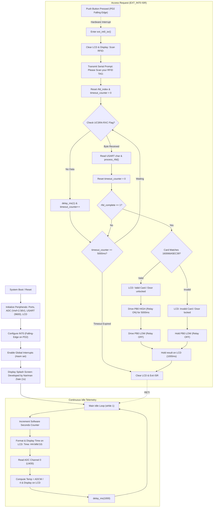

<!-- Gradient Divider -->


<!-- Dynamic Header Banner -->


<p align="center">
  <b>SmartLock RFID AVR – Digital Access Control & Environmental Telemetry System</b><br>
  <small><i>- An interrupt-driven embedded security system featuring ATmega32 microcontroller architecture, 125kHz/UART RFID credential authentication, LM35 analog temperature acquisition, software real-time clock, alphanumeric 16x2 LCD telemetry, and full Proteus mixed-signal virtual simulation -</i></small>
</p>

<p align="center">
  
  <a href="https://www.microchip.com/"></a>
  <a href="http://www.hpinfotech.com/"></a>
  <a href="https://www.microchip.com/en-us/product/ATmega32"></a>
  <a href="https://www.labcenter.com/"></a>
  <a href="LICENSE"></a>
</p>

---

## 📌 Project Status: Archived & Academic Origins

> [!NOTE]
> **Archived Repository & University Digital Systems Lab Project**  
> Originally researched, engineered, simulated, and documented by **Nariman Ziaie** (August 2024) for his university **Digital Systems Lab** coursework at **Islamic Azad University Central Tehran Branch**.  
> 
> **Academic Legacy:** This project served as a comprehensive, hands-on laboratory exploration of register-level microcontroller programming on the 8-bit AVR architecture. It implemented asynchronous serial communication (USART), 10-bit successive approximation analog-to-digital conversion (ADC), external edge-triggered hardware interrupts, and multi-line character LCD interfacing.  
> 
> **Archive Notice:** This repository is preserved in a read-only archived state for historical, educational, and reference purposes. For my latest projects, active open-source software, and engineering portfolios, explore my personal website and GitHub repositories listed below.

### 📖 The Origin Story

> *"In our university **Digital Systems Lab**, we spent weeks studying the fundamental building blocks of digital logic—combinational circuits, sequential flip-flops, registers, state machines, and timing diagrams. But theoretical logic on a whiteboard only truly comes to life when you bridge it into physical silicon, writing bare-metal firmware that commands pins, registers, and serial buses in real time.*  
> 
> *For my Digital Systems Lab course project, I wanted to build something practical that brought all these peripheral interfaces together into a unified system: a digital smart lock driven by the **ATmega32** microcontroller, programmed in C using **CodeVisionAVR**.*  
> 
> *Rather than relying on high-level abstractions, the goal was to write direct, bare-metal hardware control: orchestrating USART registers and receive flags for 12-byte RFID serial payloads, configuring an external falling-edge interrupt (`INT0`) on PD2 to trigger access requests, tuning the internal 10-bit ADC with an internal $2.56\text{V}$ bandgap reference to scale LM35 analog temperature readings, driving a 16x2 alphanumeric LCD over a 4-bit parallel bus on Port C, and simulating the complete mixed-signal circuit in Proteus with a virtual terminal.*  
> 
> *The hands-on debugging in the lab—wrestling with interrupt latency, managing input timeouts, calibrating sensor conversions, and observing the real-world limitations of delay-based software timekeeping—was an invaluable masterclass in embedded systems engineering.*  
> 
> *This repository stands as a preserved milestone of that university lab experience—a testament to foundational digital systems design, bare-metal AVR programming, and simulation-driven verification."*  
> — **Nariman Ziaie**

---

## 💡 Executive Summary & Core Capabilities

Built on an interrupt-driven embedded architecture, this firmware manages physical access control via RFID cards while maintaining continuous real-time environment telemetry and status monitoring:

* **Interrupt-Driven Access Request (`INT0`):** Access scanning is initiated via an external falling-edge hardware interrupt (`PD2`), eliminating continuous serial polling overhead and conserving CPU cycles during idle monitoring.
* **Bounded RFID Scan Timeout Window:** Once triggered, an internal $5000\,\text{ms}$ software timeout counter guards the scan window. If no valid card is received, the system aborts cleanly, preventing the controller from locking up in an indefinite wait state.
* **12-Character Serial RFID Authentication:** Receives and parses standard 12-byte ASCII hexadecimal RFID card payloads over hardware USART at 9600 baud (8-N-1), verifying card credentials against pre-stored authorized credentials (`160066A5EC39`).
* **Electro-Mechanical Solenoid / Relay Actuation:** On successful authentication, drives a logic-level transistor switch on `PORTB.0` to energize an access relay or lock solenoid for a calibrated $5000\,\text{ms}$ entry window before automatically re-locking.
* **Precision Analog Temperature Telemetry:** Samples an analog `LM35` sensor via ADC Channel 0 (`PA0`) using the ATmega32 internal $2.56\,\text{V}$ voltage reference, calculating ambient temperature with high step resolution without requiring external op-amp amplification.
* **Multi-Line Alphanumeric LCD Telemetry:** Interfaces with a 16x2 HD44780-compatible LCD over a 4-bit parallel bus (`PORTC`), rendering real-time clock telemetry (`HH:MM:SS`), ambient temperature, authentication feedback (`Valid Card` / `Invalid Card`), and door status (`Door unlocked` / `Door locked`).
* **Bidirectional Serial Diagnostic Output:** Transmits system diagnostics and access logs over the hardware UART transmitter (`PD1 / TXD`), providing remote terminal logging alongside the local display.
* **Full Mixed-Signal Proteus Virtual Simulation:** Complete end-to-end SPICE circuit model designed in Proteus Design Suite, featuring an ATmega32 virtual core, interactive push buttons, LM35 sensor stimuli, an LCD panel, and an interactive Virtual Terminal simulating RFID reader output.

---

## 📂 Repository & Project Structure

```text
SmartLock_RFID_AVR/
├── README.md                           # Comprehensive documentation & engineering runbook
├── LICENSE                             # MIT Open-Source License
├── .gitignore                          # Git ignore rules for AVR & Proteus build artifacts
└── AVR Smart Lock/
    ├── Proteus Simulation & Analysis.pdf # 20-page technical report (analysis, datasheets & lab tests)
    ├── CodeVisionAVR/                  # Firmware source & project configuration
    │   ├── SmartLock_RFID_AVR.c        # Main C firmware source code
    │   ├── SmartLock_RFID_AVR.prj      # CodeVisionAVR primary project configuration
    │   ├── SmartLock_RFID_AVR.cproj    # Atmel Studio C project file
    │   ├── SmartLock_RFID_AVR.atsln    # Microchip / Atmel Studio solution file
    │   ├── SmartLock_RFID_AVR.cfg      # Compiler workspace configuration
    │   └── Debug/                      # Compiler intermediate files & binary outputs
    │       ├── Exe/
    │       │   └── SmartLock_RFID_AVR.hex # Compiled binary machine code for flashing & simulation
    │       └── SmartLock_RFID_AVR.cof  # Common Object File (symbolic debugging)
    └── Proteus/                        # Mixed-signal SPICE circuit simulation
        ├── SmartLock_RFID_AVR.pdsprj   # Proteus schematic & interactive simulation model
        └── SmartLock_RFID_AVR.hex      # Bundled binary for immediate Proteus simulation loading
```

---

## 🔌 Hardware Specifications & Pin Mapping

> [!IMPORTANT]
> The firmware is compiled for the **ATmega32** 8-bit AVR RISC microcontroller operating at an internal/external clock frequency of **$8.000\,\text{MHz}$**. All peripheral timings (USART baud divisor, software delays, and LCD pulse widths) are calibrated for this clock base.

### Pinout Configuration Table

| Signal Name | MCU Port / Pin | Direction | Electrical Type | Circuit Function |
| :--- | :--- | :--- | :--- | :--- |
| **LM35 Analog Input** | `PA0 (ADC0)` | Input | $0 - 2.56\,\text{V}$ Analog | Samples analog voltage from LM35 temperature sensor ($10\,\text{mV}/^\circ\text{C}$) |
| **Relay / Solenoid Drive** | `PB0` | Output | 5V Logic (Active-HIGH) | Drives base of NPN switching transistor (or MOSFET) for lock relay |
| **LCD Register Select (RS)** | `PC0` | Output | 5V Logic | Selects LCD command register (`0`) or data register (`1`) |
| **LCD Read/Write (RD/RW)** | `PC1` | Output | 5V Logic | Configured for Write operations (`LOW`) |
| **LCD Enable (EN)** | `PC2` | Output | 5V Logic | Latches 4-bit data nibbles into the LCD controller |
| **LCD Data Bit 4 (D4)** | `PC4` | Output | 5V Logic | High-nibble / low-nibble parallel data bus line 4 |
| **LCD Data Bit 5 (D5)** | `PC5` | Output | 5V Logic | High-nibble / low-nibble parallel data bus line 5 |
| **LCD Data Bit 6 (D6)** | `PC6` | Output | 5V Logic | High-nibble / low-nibble parallel data bus line 6 |
| **LCD Data Bit 7 (D7)** | `PC7` | Output | 5V Logic | High-nibble / low-nibble parallel data bus line 7 |
| **USART Receiver (RXD)** | `PD0` | Input | TTL Serial (5V) | Receives 12-byte ASCII data stream from RFID reader (9600 baud) |
| **USART Transmitter (TXD)** | `PD1` | Output | TTL Serial (5V) | Transmits diagnostic logging strings to serial monitor / terminal |
| **External Interrupt 0 (`INT0`)** | `PD2` | Input | Pull-Up / Active-LOW | Connected to push button; triggers RFID scan routine on falling edge |

### Bill of Materials & Component Characteristics

| Subsystem | Component | Key Specification | Design Role |
| :--- | :--- | :--- | :--- |
| **Microcontroller** | Atmel ATmega32 | 8-bit RISC, 8 MHz, 32 KB Flash, 2 KB SRAM | Core embedded controller, interrupt handling, ADC & UART |
| **RFID Reader Module** | EM-18 / RDM6300 | 125 kHz, Wiegand / UART output (9600 baud) | Scans passive transponder tags and streams 12-digit ASCII ID |
| **Temperature Sensor** | Texas Instruments LM35DZ | $10\,\text{mV}/^\circ\text{C}$ linear scale, $-55^\circ\text{C}$ to $+150^\circ\text{C}$ | Measures ambient room temperature for environmental telemetry |
| **Visual Display** | 16x2 Character LCD | HD44780-compliant, alphanumeric, 5V | Displays real-time clock, temperature readings, and door status |
| **Actuation Switch** | NPN Transistor (2N2222 / BC547) | $I_C = 800\,\text{mA}$, $V_{CEO} = 40\,\text{V}$ | Saturated switch driving the 12V electromechanical relay coil |
| **Electromechanical Relay** | 5V/12V SPDT Relay | 10A 250VAC / 30VDC contact rating | Controls power delivery to electronic door strike or solenoid |
| **Flyback Diode** | 1N4007 | 1A, 1000V Peak Reverse Voltage | Absorbs inductive flyback voltage spikes from the relay coil |
| **Trigger Push Button** | Tactile Momentary Switch | Normally Open (NO) with pull-up resistor | Pulls `PD2 (INT0)` to Ground to initiate the RFID scan window |

---

## ⚡ Circuit Theory & Mathematical Modeling

```text
LM35 Sensor Output:
  V_out = 10 mV / °C
  At 25°C ──► V_out = 250 mV (0.250 V)

ATmega32 10-Bit ADC Conversion:
  V_ref = 2.56V (Internal Bandgap Reference)
  Resolution = 2.56V / 1024 = 2.5 mV per LSB Step

  ADC Counts = V_out / 2.5 mV = (10 mV / °C) / 2.5 mV = 4 Counts per °C
  Actual Temperature = ADC_Value / 4
```

### 1. Analog-to-Digital Conversion & Temperature Scaling
The ATmega32 integrates a 10-bit successive approximation ADC with 8 input channels. To maximize dynamic range for low-voltage sensor inputs without requiring external operational amplifiers, the firmware configures the internal $2.56\,\text{V}$ voltage reference (`ADC_VREF_TYPE = 0xC0`, selecting `REFS1:0 = 11`):

$$\text{LSB Resolution} = \frac{V_{\text{REF}}}{2^{10}} = \frac{2.56\,\text{V}}{1024} = 0.0025\,\text{V} = 2.5\,\text{mV}$$

The LM35 produces a calibrated linear output of $10\,\text{mV}/^\circ\text{C}$:
$$V_{\text{LM35}}(T) = 10\,\frac{\text{mV}}{^\circ\text{C}} \times T$$

Substituting $V_{\text{LM35}}$ into the ADC digital output equation:
$$\text{ADCW} = \frac{V_{\text{LM35}}}{\text{LSB Resolution}} = \frac{10\,\text{mV} \times T}{2.5\,\text{mV}} = 4 \times T$$

Solving for temperature ($T$ in $^\circ\text{C}$):
$$T = \frac{\text{ADCW}}{4}$$

This mathematical relationship allows direct integer division (`temperature / 4`) in the firmware, eliminating floating-point arithmetic overhead on an 8-bit microcontroller.

### 2. USART Baud Rate Derivation
The asynchronous serial interface operates at $9600\,\text{baud}$ with an $8.000\,\text{MHz}$ system oscillator clock in normal speed mode ($U2X = 0$). The baud rate register value ($UBRR$) is derived from:

$$UBRR = \frac{F_{\text{OSC}}}{16 \times \text{Baud}} - 1 = \frac{8{,}000{,}000}{16 \times 9600} - 1 = \frac{500{,}000}{9600} - 1 \approx 52.083 - 1 = 51.083$$

Using integer value $UBRR = 51$:
$$\text{Actual Baud Rate} = \frac{8{,}000{,}000}{16 \times (51 + 1)} = \frac{8{,}000{,}000}{832} \approx 9615.38\,\text{baud}$$

$$\text{Percentage Error} = \frac{9615.38 - 9600}{9600} \times 100\% \approx +0.16\%$$

An error of $0.16\%$ is well within the acceptable RS-232 / UART tolerance limit ($\pm 2\%$), ensuring error-free communication with RFID readers and virtual terminal interfaces.

### 3. RFID Frame Protocol
Standard 125 kHz RFID modules (such as EM-18) transmit a 14-byte serial packet containing 12 ASCII characters (10 hexadecimal card number characters + 2 checksum characters) framed by Start-of-Text (`STX = 0x02`) and End-of-Text (`ETX = 0x03`):

$$\underbrace{\text{STX}}_{\text{0x02}} \quad \underbrace{\text{D}_1 \text{ D}_2 \text{ D}_3 \text{ D}_4 \text{ D}_5 \text{ D}_6 \text{ D}_7 \text{ D}_8}_{\text{Card ID (8 ASCII Hex)}} \quad \underbrace{\text{C}_1 \text{ C}_2}_{\text{Checksum}} \quad \underbrace{\text{ETX}}_{\text{0x03}}$$

In this project, the firmware reads a 12-character alphanumeric payload (`RFID_LENGTH = 12`) and matches it directly against the pre-configured authorization key `"160066A5EC39"`.

---

## 🔄 Firmware Architecture & State Machine

The firmware executes an interrupt-driven state machine splitting execution between idle monitoring and credential authentication:



---

## 🧪 Proteus Simulation & Verification Runbook

The complete circuit is modeled in **Proteus Design Suite** ([`AVR Smart Lock/Proteus/SmartLock_RFID_AVR.pdsprj`](AVR%20Smart%20Lock/Proteus/SmartLock_RFID_AVR.pdsprj)) using the precompiled binary [`AVR Smart Lock/Proteus/SmartLock_RFID_AVR.hex`](AVR%20Smart%20Lock/Proteus/SmartLock_RFID_AVR.hex).

### Interactive Virtual Simulation Setup

```text
[Push Button (PD2)] ────────► External Interrupt 0 (INT0 Falling Edge Trigger)
[Virtual Terminal (TX/RX)] ──► Serial RFID Tag Data Injection (9600 Baud)
[LM35 Potentiometer (ADC0)] ──► Variable Analog Voltage Input (0 - 2.56V)
[16x2 LM016L LCD (PORTC)] ───► Real-Time System Telemetry Display
[Relay & Indicator LED (PB0)] ─► Access Actuation & Door Strike Simulation
```

### Step-by-Step Simulation Procedure
1. Open [`SmartLock_RFID_AVR.pdsprj`](AVR%20Smart%20Lock/Proteus/SmartLock_RFID_AVR.pdsprj) in **Proteus 8.x**.
2. Double-click the **ATmega32** microcontroller symbol. Verify that:
   * **Program File:** Points to `..\CodeVisionAVR\Debug\Exe\SmartLock_RFID_AVR.hex` (or local `SmartLock_RFID_AVR.hex`).
   * **Clock Frequency:** Configured to `8000000` ($8\,\text{MHz}$).
3. Click the **Play / Run Simulation** button in the lower toolbar.
4. **Boot Sequence:** Observe the LCD displaying the developer splash screen for 1 second, followed by live clock and temperature updates:
   ```text
   +----------------+
   |Time: 00:00:01  |
   |Actual Temp=25  |
   +----------------+
   ```
5. **Adjusting Temperature:** Adjust the LM35 sensor value in Proteus; verify that the LCD line 2 updates immediately to reflect the new temperature.
6. **Simulating Card Scan:**
   * Press the momentary tactile button connected to **`PD2`**.
   * The LCD clears and displays: `"Scan RFID:"`.
   * The Proteus **Virtual Terminal** prints: `"Please Scan your RFID TAG:"`.
7. **Testing Valid Access:**
   * In the Virtual Terminal window, type: `160066A5EC39`.
   * Observe the LCD updating to:
     ```text
     +----------------+
     |Valid Card      |
     |Door unlocked   |
     +----------------+
     ```
   * The indicator LED turns ON, and the relay switches state for exactly $5\,\text{seconds}$ before automatically turning OFF.
8. **Testing Invalid Access:**
   * Press the button again to trigger scan mode.
   * Type an arbitrary 12-digit string (e.g., `112233445566`).
   * Observe the LCD displaying `"Invalid Card / Door locked"`; the relay remains de-energized.
9. **Testing Timeout Behavior:**
   * Press the trigger button and do not type any input.
   * After $5\,\text{seconds}$, the scanning mode aborts automatically, clearing the LCD and resuming standard clock/temperature display.

---

## 🔬 Technical Report & Documentation Summary

The repository includes a comprehensive 20-page technical monograph and engineering report ([`AVR Smart Lock/Proteus Simulation & Analysis.pdf`](AVR%20Smart%20Lock/Proteus%20Simulation%20&%20Analysis.pdf)) detailing the academic and circuit design foundation:

* **Section 1 (Introduction & Project Scope):** Theoretical objectives, microcontroller core selection criteria, and architectural overview.
* **Section 2 (Hardware Analysis & Datasheets):** Complete electrical analysis of the ATmega32 architecture, LM35 thermal characteristics, HD44780 LCD pin specifications, and EM-18 RFID module protocols.
* **Section 2-3 (Circuit Optimization Proposals):** Architectural recommendations for replacing software timekeeping with an external I2C **DS1307 Real-Time Clock** (with coin-cell battery backup) and migrating to digital 1-Wire **DS18B20** temperature sensing.
* **Section 2-4 (CodeVisionAVR Peripheral Configuration):** Step-by-step register setup instructions for ports, timers, ADC, USART, and external interrupt vectors.
* **Section 3 (Software Architecture & Flowcharts):** Line-by-line code annotations and functional block decomposition.

---

## 🚀 Getting Started & Build Runbook

### Prerequisites & Toolchain
* **Compiler / IDE:** [CodeVisionAVR](http://www.hpinfotech.com/) (v3.x or higher) or [Microchip Studio](https://www.microchip.com/en-us/tools-resources/develop/microchip-studio) (formerly Atmel Studio 7).
* **Circuit Simulation:** [Labcenter Electronics Proteus Design Suite](https://www.labcenter.com/) (v8.9 SP0 or higher).
* **Hardware (Optional for physical bench build):** ATmega32 development board, USB-to-UART programmer (USBasp / AVRISP mkII), EM-18 RFID Reader with $125\,\text{kHz}$ tags, LM35 sensor, 16x2 LCD, 5V relay module.

### Step 1: Clone Repository
```bash
git clone https://github.com/Nariman-Z/SmartLock_RFID_AVR.git
cd SmartLock_RFID_AVR
```

### Step 2: Open and Compile Firmware
1. Launch **CodeVisionAVR**.
2. Open [`AVR Smart Lock/CodeVisionAVR/SmartLock_RFID_AVR.prj`](AVR%20Smart%20Lock/CodeVisionAVR/SmartLock_RFID_AVR.prj).
3. Select **Project $\to$ Compile** (`F9`) followed by **Project $\to$ Build-All** (`Ctrl + F9`).
4. Verify that the build succeeds without compilation errors. The compiler outputs:
   ```text
   Target: ATmega32
   Clock: 8.000000 MHz
   Memory Model: Small
   FLASH usage: ~8% (approx. 2.6 KB)
   SRAM usage: ~12% (approx. 250 Bytes)
   ```
5. The generated binary will be exported to `AVR Smart Lock/CodeVisionAVR/Debug/Exe/SmartLock_RFID_AVR.hex`.

---

## 🔍 Diagnostics, Known Limitations & Architectural Analysis

> [!WARNING]
> **Academic Prototype & Known Architectural Limitations**  
> As an undergraduate academic research project, the firmware prioritizes simplicity, educational clarity, and simulation demonstration. Consequently, the codebase contains several known architectural anti-patterns and design trade-offs that are documented below for technical transparency:

### Summary Diagnostics Table

| Symptom | Probable Root Cause | Corrective Action |
| :--- | :--- | :--- |
| **Time display freezes during RFID scan** | Blocking delay inside ISR (`ext_int0_isr`) | Migrate scan state machine out of ISR and into non-blocking main loop. |
| **Clock drifts noticeably over hours** | Software delay (`delay_ms`) timekeeping | Replace software loop with hardware Timer2 asynchronous RTC or external DS1307. |
| **LCD displays blank or garbled characters** | Uninitialized 4-bit nibble latch timing | Ensure `lcd_init(16)` execution and verify Port C control lines (`PC0-PC2`). |
| **RFID scan times out despite card presence** | Baud rate mismatch or inverted serial logic | Verify RFID reader operates at 9600 baud, 8-N-1 TTL (non-inverted). |
| **Relay chatters or fails to latch** | Insufficient transistor base drive current | Ensure base resistor is sized for saturation ($1\,\text{k}\Omega - 2.2\,\text{k}\Omega$). |

### Deep-Dive Architectural Critique

#### 1. Blocking Delays Inside Interrupt Service Routine (ISR)
* **Observed Implementation:** In [`SmartLock_RFID_AVR.c`](AVR%20Smart%20Lock/CodeVisionAVR/SmartLock_RFID_AVR.c), `ext_int0_isr()` contains a `while (timeout_counter < TIMEOUT_THRESHOLD)` polling loop and an explicit `delay_ms(5000)` call on successful card entry.
* **Architectural Flaw:** On AVR architectures, entering an ISR clears the global interrupt flag (`SREG.I = 0`). Remaining inside an ISR for $5 - 6\,\text{seconds}$ blocks the entire processor, prevents nested interrupt servicing, and halts foreground execution.
* **Production Recommendation:** The ISR should merely set a volatile flag (`volatile uint8_t rfid_scan_requested = 1;`) and exit immediately. The scanning loop, timeouts, and relay delay should be handled asynchronously via non-blocking state machines in the main loop.

#### 2. Software Delay-Based Real-Time Clock
* **Observed Implementation:** The system clock increments seconds inside the main `while(1)` loop separated by `delay_ms(1000)`.
* **Architectural Flaw:** The execution time of `sprintf`, `lcd_puts`, and `read_adc(0)` adds cumulative latency on every cycle. Furthermore, any time spent executing the RFID ISR completely freezes the clock. Over a 24-hour period, cumulative drift will exceed several minutes.
* **Production Recommendation:** Interface an external I2C RTC (such as Dallas **DS1307** / **DS3231**) with an independent $32.768\,\text{kHz}$ quartz crystal and battery backup, or configure ATmega32 Timer2 in asynchronous oscillator mode with a watch crystal across `TOSC1/TOSC2`.

#### 3. Single Hardcoded Credential in Flash
* **Observed Implementation:** The card verification check executes `strncmp(rfid, "160066A5EC39", RFID_LENGTH)`.
* **Architectural Flaw:** Only one fixed card can access the system. Enrolling new cards or revoking access requires re-compiling and re-flashing the microcontroller firmware.
* **Production Recommendation:** Implement an internal EEPROM lookup table storing authorized card hash identifiers, accompanied by an administrative enrollment mode initiated via a master key card.

#### 4. Dead Code Function (`usart_receive_string`)
* **Observed Implementation:** The function `usart_receive_string()` allocates a local stack buffer `char str[13]`, reads 13 characters, and returns `*str` (a single `unsigned char`).
* **Architectural Flaw:** Returning `*str` dereferences the first character only, and the function is never called by the application logic. It remains in the source code as legacy unused boilerplate.

#### 5. Voltage Reference Configuration Comment
* **Observed Implementation:** The code specifies `#define ADC_VREF_TYPE 0xC0` with a comment stating `// Voltage Reference: AREF pin`.
* **Architectural Note:** In the ATmega32 `ADMUX` register, bits `REFS1:0 = 11` (`0xC0`) select the **Internal $2.56\,\text{V}$ Voltage Reference**, not the external AREF pin. The formula `temperature / 4` correctly depends on the internal $2.56\,\text{V}$ reference ($2.56\,\text{V} / 1024 \approx 2.5\,\text{mV}/\text{LSB}$); thus the hardware operation is mathematically sound despite the legacy comment discrepancy.

---

## 🏛️ Project Archive & More Projects

> [!IMPORTANT]
> **This repository is officially archived.**  
> `SmartLock_RFID_AVR` reflects foundational academic coursework and bare-metal embedded prototyping completed during university laboratory studies. Active development has concluded, and this repository is preserved for reference.
>
> To explore my latest active engineering projects, research, and open-source work:

### 🌐 [Personal Website & Portfolio](https://nariman-z.pages.dev/)
* **Official URL:** [**nariman-z.pages.dev**](https://nariman-z.pages.dev/)
* **Overview:** Comprehensive showcase of embedded engineering projects, hardware systems, full-stack software development, technical articles, and interactive demos.

### 💻 [GitHub Repositories](https://github.com/Nariman-Z?tab=repositories)
* **GitHub Profile:** [**github.com/Nariman-Z**](https://github.com/Nariman-Z)
* **Repository Catalog:** [**github.com/Nariman-Z?tab=repositories**](https://github.com/Nariman-Z?tab=repositories)
* **Overview:** Complete collection of open-source repositories spanning microcontroller firmware, IoT architectures, circuit simulations, web platforms, and mobile applications.

---

## 📄 License & Developer Attribution

Licensed under the terms of the **MIT License**. See the full [`LICENSE`](LICENSE) file for complete details.

---

<div align="center">

### Made with ❤️ by [Nariman_Z](https://github.com/Nariman-Z)  
🌐 [Personal Website & Portfolio](https://nariman-z.pages.dev/)

</div>

<!-- Gradient Divider -->


_Last Update: November 2026_
